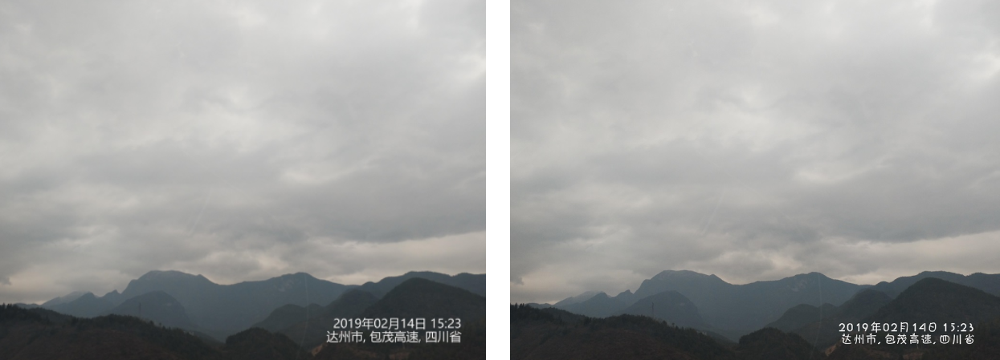

# 打印EXIF信息到图片

**简体中文** | [English](README_en.md)

## 介绍

该脚本可以从图片中读取EXIF信息，提取拍摄时间和GPS坐标，并使用这些数据获取详细的地址信息。然后，它会将这些信息添加到图片上，并保存带有地理位置标签和时间戳的新图片。

## 示例图片



## 功能

- 读取图片EXIF信息
- 从GPS坐标反解析地址
- 将时间戳和地址添加到图片上
- 支持中文地址格式
- 自动重试和处理失败的操作
- 支持 高德地图API 和 Nominatim API

## 环境要求

- Python版本: 3.7 或更高
- 操作系统: Windows, macOS, Linux

## 安装要求

运行此脚本需要安装以下Python模块：

- `Pillow`（代码中以 `PIL` 引入）
- `geopy`
- `piexif`
- `requests`

`datetime` 属于 Python 标准库，无需安装。

请使用 `pip install -r requirements.txt` 来安装所需的库。

## 使用方法
**这是此项目的`命令行`版本，我们已为您构建了`EXE`可执行文件，您可以直接 [下载使用](https://github.com/fjd2004711/print-exif-to-photo/releases)，或切换到 [GUI分支](https://github.com/fjd2004711/print-exif-to-photo/tree/GUI) 构建项目。**
> **运行前须知**：脚本在进入交互前会先探测 Nominatim（`lib/geolocation.py` 中的 `is_nominatim_online()`）是否可达；探测失败会直接 `sys.exit(1)` 退出，**即使你打算使用高德地图 API 也一样**。国内网络环境请先配置代理，否则会在第一步就中断。

1. 确保所有的图片（当前仅处理 `.jpg`）都放在 `images` 文件夹中。
2. 在 `config/config.json` 中配置 `amap_api_key`（选择高德地图 API 时必填）。
3. 运行脚本：

```bash
python main.py
```

脚本会依次在命令行询问两项设置：

1. 地址解析 API：输入 `1` 使用高德地图 API（需配置 key），输入 `2` 使用 Nominatim；
2. 要打印到图片上的信息：输入序号并用逗号分隔，例如 `1,2,3`（依次为 时间、地址、光圈、ISO、快门速度）。

处理结果会写入 `images/` 下的三个子目录：

| 目录 | 内容 |
| --- | --- |
| `images/tagged_images/` | 处理成功、已打上时间戳和地址的新图片 |
| `images/no_exif_images/` | 取不到时间/经纬度的图片（原图另存一份，不加字） |
| `images/failed_images/` | 处理中报错的图片（原图另存为 `failed_<文件名>`，排查后可重跑） |

### 更改字体及样式

- 将字体文件放入 `fonts`  文件夹（仓库里的 `fonts/` 是空目录，不含任何字体文件）。
- 修改`config/style.json`中 `font_path` 的字体路径。 （例如`fonts/example.ttf`，默认为`msyh.ttc`[微软雅黑]，需要自行放在项目根目录或写成绝对路径）

> 注意：`font_path` 会原样传给 `PIL.ImageFont.truetype()`（`lib/image_utils.py`）。若默认的微软雅黑不存在，第一张图就会抛 `OSError: cannot open resource`，原图被整体复制进 `images/failed_images/`，看起来像"全部处理失败"。Linux / macOS 用户请显式改成自己的字体，例如 `fonts/SourceHanSansSC-Regular.otf` 或 `/System/Library/Fonts/PingFang.ttc`。

#### 配置文件说明

- `font_path`: 使用的字体文件的路径。
- `margin_scale`: 边距比例，定义为图片宽度的一部分。
- `font_size_scale_landscape`: 横向图片的字体大小缩放因子。
- `font_size_scale_portrait`: 纵向图片的字体大小缩放因子。
- `min_font_size`: 文本的最小字体大小。
- `shadow_color`: 文本阴影的颜色。
- `shadow_offset`: 文本阴影的偏移量（以像素为单位）。
- `text_color`: 文本的颜色。
- `spacing`: 行间距，即行与行之间的垂直距离。

### 详细使用教程

[blog.renetxi.com](https://blog.renetxi.com/archives/866)

## 故障排除

如果在图片处理过程中遇到任何问题，如EXIF信息读取失败或地址解析错误，请检查您的图片文件是否损坏，以及网络连接是否正常。

## 贡献

如果您有任何改进建议或功能请求，请创建一个issue或者提交一个拉取请求（pull request）。

## 许可证

本项目采用 GPL-3.0 许可证。详情请见 `LICENSE` 文件。        