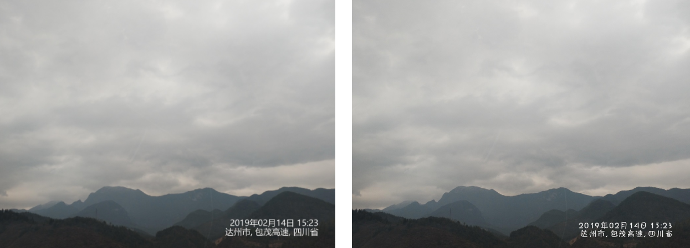

# Print EXIF Information onto Photos

**English** | [简体中文](README.md)

## Introduction

This script can read EXIF information from photos, extract the shooting time and GPS coordinates, and use this data to obtain detailed address information. It then adds this information onto the photos, saving new images with geographic location tags and timestamps.

## Sample Image



## Features

- Read EXIF information from photos
- Reverse geocode addresses from GPS coordinates
- Add timestamps and addresses onto photos
- Support for Chinese address format
- Automatic retry and handling of failed operations

## Environment Requirements

- Python version: 3.7 or higher
- Operating Systems: Windows, macOS, Linux
- Proxy environment may be required for users in China

## Installation Requirements

The following Python modules are required to run this script:

- `Pillow` (imported as `PIL`)
- `geopy`
- `piexif`
- `requests`

`datetime` is part of the Python standard library and does not need to be installed.

Use the command `pip install -r requirements.txt` to install these libraries.

## How to Use

**This is the `command line` version of the project. We have built an `EXE` executable file for you to [use directly](https://github.com/fjd2004711/print-exif-to-photo/releases), or you can switch to the [GUI branch](https://github.com/fjd2004711/print-exif-to-photo/tree/GUI) to build the project.**

> **Before you run it**: the script first probes whether Nominatim is reachable (`is_nominatim_online()` in `lib/geolocation.py`) and calls `sys.exit(1)` if it is not — even when you intend to use the Amap API. Users in mainland China need a proxy configured beforehand, otherwise the run aborts at the first step.

1. Ensure all images (only `.jpg` is processed) are placed in the `images` folder.
2. Configure `amap_api_key` in `config/config.json` (required when using the Amap API).
3. Run the script:

```bash
python main.py
```

The script then asks two questions on the command line:

1. Geocoding API: `1` for the Amap API (needs a key), `2` for Nominatim;
2. Which fields to print on the photo: indexes separated by commas, e.g. `1,2,3` (time, address, aperture, ISO, shutter speed).

Results are written into three subfolders of `images/`:

| Folder | Contents |
| --- | --- |
| `images/tagged_images/` | Successful output, with timestamp and address burned in |
| `images/no_exif_images/` | Images without usable time/coordinates (original copied, untouched) |
| `images/failed_images/` | Images that errored during processing (original copied as `failed_<name>`) |

### Changing Fonts and Styles

- Add font files to the `fonts` folder (the `fonts/` directory in this repo is empty and ships no font).
- Update the `font_path` in `config/style.json` to the desired font path (e.g., `fonts/example.ttf`; the default is `msyh.ttc` for Microsoft YaHei, which you must place in the project root or reference by absolute path).

> Note: `font_path` is passed straight to `PIL.ImageFont.truetype()` (`lib/image_utils.py`). If the default Microsoft YaHei font is missing, the first image raises `OSError: cannot open resource` and every original is copied into `images/failed_images/`, which looks like "everything failed". On Linux / macOS, point it at a font you actually have, e.g. `fonts/SourceHanSansSC-Regular.otf` or `/System/Library/Fonts/PingFang.ttc`.

#### Configuration File Description

- `font_path`: The path to the font file being used.
- `margin_scale`: The margin ratio, defined as a portion of the image width.
- `font_size_scale_landscape`: The font size scaling factor for landscape images.
- `font_size_scale_portrait`: The font size scaling factor for portrait images.
- `min_font_size`: The minimum font size for text.
- `shadow_color`: The color of the text shadow.
- `shadow_offset`: The offset for the text shadow, in pixels.
- `text_color`: The color of the text.
- `spacing`: The line spacing or the vertical distance between lines.

### Detailed Usage Tutorial

For a detailed usage tutorial, visit [blog.renetxi.com](https://blog.renetxi.com/archives/866).

## Troubleshooting

If you encounter any issues such as EXIF information not being read or address resolution errors, check whether your image files are corrupted and your network connection is functioning properly.

## Contributions

For suggestions for improvements or feature requests, please create an issue or submit a pull request.

## License

This project is licensed under the GPL-3.0 license. For more details, see the `LICENSE` file.  

